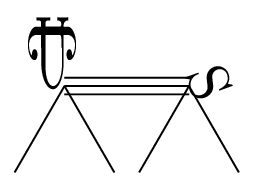

# bondcow

`bondcow` started as a bond counter, but it now also counts atoms and atoms by hybridization. It's a `julia` program, but it uses python's `rdkit` as backend.

<div align="center">
  
</div>

# Usage

Suppose you have the file `usertest-bondcow.smi` containing a handful of smiles:

```
C
N
O
C=O
C#N
c1ccccc1
mooooooooooooooo
```

That's methane, ammonia, water, formaldehyde, hydrogen cyanide, benzene, and a cow's moo.

## Bond list

You can get a list of all bond types in the molecules of this file by running the program like this:

```
$:julia bondcow.jl usertest-bondcow.smi
```

Bond-mode is the default, so you don't have to pass additional flags. Alternatively, you can also call the program like this:

```
$:julia bondcow.jl usertest-bondcow.smi -b
$:julia bondcow.jl --bond usertest-bondcow.smi
```

The output is printed to screen:

```
usertest-bondcow.smi 8
8 18 26
1 14.29

== hat-hat bonds
3
1 ; C C a ; 6  75.0 23.08
2 ; C O d ; 1  12.5  3.85
3 ; C N t ; 1  12.5  3.85

== light-atom bonds
3
1 ; H C s ; 13 72.22  50.0
2 ; H N s ;  3 16.67 11.54
3 ; H O s ;  2 11.11  7.69

== anomaly bonds
0
```

The first block always has 3 lines. It lists:
1. The input filename and is linecount.
2. The amount of bonds between heavy atoms (8), the amount of bonds involving light atoms (18), and the total amount of bonds in the file (26).
3. The amount of lines that couldn't be parsed by `rdkit` and the percentage of the file that this corresponds to. For this file, the line `mooooooooooooooo` couldn't be parsed as a smiles, which corresponds to nearly 15% of the file.

The second and third block vary in size depending on the amount of bond types found. The second block has:
1. A header (`hat` means "heavy atom").
2. The amount of bond types (only for those only involving heavy atoms: carbon, nitrogen, oxygen, and so on, but not hydrogen).
3. Any further lines list:
    * the index of the bond type within this list,
    * the atoms involved and the bond type (`C C a` means "aromatic carbon-carbon bond", `C O d` means "double carbon-oxygen bond", and so on),
    * the amount of bonds of this type, the percentage this corresponds to within the including-light-atoms bond class, and the percentage this corresponds to considering all bonds in the file.

The third block has the same structure, but it lists:
1. A header.
2. The amount of bond types (only for those involving hydrogen).
3. Any further lines list:
    * the index of the bond type within this list,
    * the atoms involved and the bond type (`H C s` means "hydrogen-carbon single-bond", and so on),
    * the amount of bonds of this type, the percentage this corresponds to within the heavy-atoms-only bond class, and the percentage this corresponds to considering all bonds in the file.

The fourth block lists any 'anomaly' bonds found in the file (that is, not single nor double nor triple nor aromatic).

You can save this output to disk by doing, say,
```
$:julia bondcow.jl usertest-bondcow.smi > bncw-b-usertest-bondcow.out
```

## Atom list (by types)

Any of these commands compute the atom list for the example file from earlier:

```
$:julia bondcow.jl usertest-bondcow.smi -a
$:julia bondcow.jl -a usertest-bondcow.smi
$:julia bondcow.jl --atom usertest-bondcow.smi
```

The program's output is printed to screen:

```
usertest-bondcow.smi 8
13 18 31
1 14.29

== atom counts
4
1 ; C ;  9 69.23 29.03
2 ; N ;  2 15.38  6.45
3 ; O ;  2 15.38  6.45
4 ; H ; 18  0.00 58.06
```

The first block lists:
1. The input filename and its linecount.
2. The amount of heavy atoms (13), hydrogens (18) and total atoms (31).
3. The amount of lines that couldn't be parsed by `rdkit` and the percentage of the file that this corresponds to. For this file, the line `mooooooooooooooo` couldn't be parsed as a smiles, which corresponds to nearly 15% of the file.

The second (and final) block lists:
1. A header.
2. The amount of atom types.
3. Any further lines list:
    * the index of the atom type within this list,
    * the atom type,
    * the amount of times it appears, the percentage this corresponds to within the heavy-atoms-only bond class, and the percentage this corresponds to considering all atoms in the file.

Once again, you can save the output to disk by running a command like this:

```
$:julia bondcow.jl usertest-bondcow.smi -a > bncw-a-usertest-bondcow.out
```

## Atom list (by hybridization)

Any of these commands compute the atoms-by-hybridization list for the example file from earlier:

```
$:julia bondcow.jl usertest-bondcow.smi -y
$:julia bondcow.jl --hyb usertest-bondcow.smi
$:julia bondcow.jl usertest-bondcow.smi --hybridization
```

```
usertest-bondcow.smi 8
13 18 31
1 14.29

== atom counts
8
1 ; C_sp2 ;  7 53.85 22.58
2 ; C_sp3 ;  1  7.69  3.23
3 ; N_sp3 ;  1  7.69  3.23
4 ; O_sp3 ;  1  7.69  3.23
5 ; O_sp2 ;  1  7.69  3.23
6 ; C_sp  ;  1  7.69  3.23
7 ; N_sp  ;  1  7.69  3.23
8 ; H     ; 18  0.00 58.06
```

The structure of `bondcow`'s output is the same as that from the `-a` mode above. The first block is identical:
1. The input filename and its linecount.
2. The amount of heavy atoms (13), hydrogens (18) and total atoms (31).
3. The amount of lines that couldn't be parsed by `rdkit` and the percentage of the file that this corresponds to. For this file, the line `mooooooooooooooo` couldn't be parsed as a smiles, which corresponds to nearly 15% of the file.

The second (and final) block lists the atoms by hybridization:
1. A header.
2. The amount of atom types (considering their hybridization).
3. Any further lines list:
    * the index of the atom type within this list,
    * the atom type (its symbol and hybridization),
    * the amount of times it appears, the percentage this corresponds to within the heavy-atoms-only bond class, and the percentage this corresponds to considering all atoms in the file.

Save the output to disk by running a command like this:

```
$:julia bondcow.jl usertest-bondcow.smi -y > bncw-y-usertest-bondcow.out
```

# Requirements and install instructions

## The `julia` part

First off, download these files to a folder named, say, `Bondcow`: `bondcow.jl`, `machinery-bondcow.jl`, `machinery_bondcow.py`, `usertest-bondcow.smi`. The rest of the steps are installing software.

`bondcow` requires a `julia` install, plus two packages:
* `PlainCLIArgs.jl`
* `PyCall.jl`

You can find the julia install instructions [here](https://julialang.org/downloads/) (or the manual-download instructions [here](https://julialang.org/downloads/manual-downloads/)). 

Once `julia` is installed, you can install the required packages by running this command from a `julia` REPL or a notebook:

```
import Pkg; Pkg.add(["PlainCLIArgs","PyCall"])
```

Alternatively, you can run either of these commands from the terminal:

```
$:julia bondcow.jl -r
$:julia bondcow.jl --install-requirements
```

## The python part

`bondcow` also requires python and `rdkit` to be available. [Here are `rdkit`'s install instructions](https://www.rdkit.org/docs/Install.html). In case the install process seems to work *but* `bondcow` doesn't work, I can offer you:
* Commiseration in the form of [xkcd 1987](https://xkcd.com/1987/).
* A command that tests whether `rdkit` is reachable:

```
$:python3 -c "import rdkit; print(rdkit.__version__)"
```

It should print something like this:

```
2023.09.3
```

# Examples of "real" output files

Here's file `bncw-b-smis1-qm9.out`. It lists the bond types in QM9.

```
smis1-qm9.smi 133885
1258966 1230122 2489088
0 0.0

== hat-hat bonds
16
 1 ; C C s ; 663029 52.66 26.64
 2 ; C O s ; 188373 14.96  7.57
 3 ; C N s ; 139309 11.07   5.6
 4 ; C O d ;  56040  4.45  2.25
 5 ; C N a ;  55863  4.44  2.24
 6 ; C C a ;  43953  3.49  1.77
 7 ; C N d ;  20799  1.65  0.84
 8 ; C C t ;  19527  1.55  0.78
 9 ; C C d ;  17616   1.4  0.71
10 ; C N t ;  17500  1.39   0.7
11 ; C O a ;  15294  1.21  0.61
12 ; N N a ;  11085  0.88  0.45
13 ; N O a ;   5054   0.4   0.2
14 ; C F s ;   3314  0.26  0.13
15 ; N O s ;   2068  0.16  0.08
16 ; N O d ;    142  0.01  0.01

== light-atom bonds
3
 1 ; H C s ; 1104294 89.77 44.37
 2 ; H N s ;   74514  6.06  2.99
 3 ; H O s ;   51314  4.17  2.06

== anomaly bonds
0
```

Here's file `bncw-a-smis1-qm9.out`. It lists the atom types in QM9.

```
smis1-qm9.smi 133885
1177631 1230122 2407753
0 0.0

== atom counts
5
1 ; C ;  846556 71.89 35.16
2 ; O ;  187997 15.96  7.81
3 ; N ;  139764 11.87   5.8
4 ; F ;    3314  0.28  0.14
5 ; H ; 1230122  0.00 51.09
```

Here's file `bncw-y-smis1-qm9.out`. It lists the atom types in QM9, considering their hybridization.

```
smis1-qm9.smi 133885
1177631 1230122 2407753
0 0.0

== atom counts
10
 1 ; C_sp3 ;  605922 51.45 25.17
 2 ; C_sp2 ;  184080 15.63  7.65
 3 ; O_sp3 ;   95208  8.08  3.95
 4 ; O_sp2 ;   92789  7.88  3.85
 5 ; N_sp2 ;   90627   7.7  3.76
 6 ; C_sp  ;   56554   4.8  2.35
 7 ; N_sp3 ;   31637  2.69  1.31
 8 ; N_sp  ;   17500  1.49  0.73
 9 ; F_sp3 ;    3314  0.28  0.14
10 ; H     ; 1230122  0.00 51.09
```

