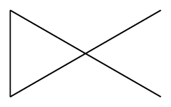

# bondcow

`bondcow` started as a bond counter, but it now also counts atoms, atoms by hybridization, formulas, and tokens. It's a `julia` program, although it uses python's `rdkit` as backend.

<div align="center">
  
</div>

## Table of contents

- [Usage](#usage)
  - [Bond list](#bond-list)
  - [Atom list (by types)](#atom-list-by-types)
  - [Atom list (by hybridization)](#atom-list-by-hybridization)
  - [Token list](#token-list)
  - [Formula list](#formula-list)
  - [Skip certain molecules](#skip-certain-molecules)
- [Requirements and install instructions](#requirements-and-install-instructions)
  - [The `julia` part](#the-julia-part)
  - [The python part](#the-python-part)
- [Examples of 'real' output files](#examples-of-real-output-files)
  - [QM9 bond list](#qm9-bond-list)
  - [QM9 atom list](#qm9-atom-list)
  - [QM9 atom list (by hybridization)](#qm9-atom-list-by-hybridization)
  - [QM9 token list](#qm9-token-list)
  - [QM9 formula list](#qm9-formula-list)

# Usage

Suppose you have the file `usertest-bondcow.smi` containing a handful of smiles:

```
C
N
O
C=O
C#N
c1ccccc1
mooooooooooooooo
```

That's methane, ammonia, water, formaldehyde, hydrogen cyanide, benzene, and a cow's moo.

## Bond list

You can get a list of all bond types in the molecules of this file by running the program like this:

```
$:julia bondcow.jl usertest-bondcow.smi
$:julia bondcow.jl usertest-bondcow.smi -b
$:julia bondcow.jl --bond usertest-bondcow.smi
```

Bond-mode is the default, so you don't have to pass additional flags. The output filename is derived from the input filename (for this example, it's `bncw-b-usertest-bondcow.out`). Alternatively, you can also call the program like this:

```
$:julia bondcow.jl usertest-bondcow.smi -bp
$:julia bondcow.jl --bond -p usertest-bondcow.smi
```
The output file is created just as before, but the output is also written to stdout because of the `-p` (thus we see it on the screen).

Here's the output:

```
usertest-bondcow.smi 7
1 14.29
8 18 26

== hat-hat bonds
3
1 ; C C a ; 6  75.0 23.08
2 ; C O d ; 1  12.5  3.85
3 ; C N t ; 1  12.5  3.85

== light-atom bonds
3
1 ; H C s ; 13 72.22  50.0
2 ; H N s ;  3 16.67 11.54
3 ; H O s ;  2 11.11  7.69

== anomaly bonds
0
```

The first block always has 3 lines. It lists:
1. The input filename and its linecount.
2. The amount of lines that couldn't be parsed by `rdkit` and the percentage of molecules that this corresponds to. For this file, the line `mooooooooooooooo` couldn't be parsed as a smiles, which corresponds to nearly 15% of the samples.
3. The amount of bonds between heavy atoms (8), the amount of bonds involving light atoms (18), and the total amount of bonds in the file (26).

The second and third blocks vary in size depending on the amount of bond types found. The second block has:
1. A header (`hat` means "heavy atom").
2. The amount of bond types (only for those only involving heavy atoms: carbon, nitrogen, oxygen, and so on, but not hydrogen).
3. Any further lines list:
    * the index of the bond type within this list,
    * the atoms involved and the bond type (`C C a` means "aromatic carbon-carbon bond", `C O d` means "double carbon-oxygen bond", and so on),
    * the amount of bonds of this type, the percentage this corresponds to within the heavy-atoms-only bond class, and the percentage this corresponds to considering all bonds in the file.

The third block has the same structure, but it lists:
1. A header.
2. The amount of bond types (only for those involving hydrogen).
3. Any further lines list:
    * the index of the bond type within this list,
    * the atoms involved and the bond type (`H C s` means "hydrogen-carbon single-bond", and so on),
    * the amount of bonds of this type, the percentage this corresponds to within the light-atoms-included bond class, and the percentage this corresponds to considering all bonds in the file.

The fourth block lists any 'anomaly' bonds found in the file (that is, not single nor double nor triple nor aromatic).

## Atom list (by types)

Any of these commands compute the atom list for the example file from earlier:

```
$:julia bondcow.jl usertest-bondcow.smi -a
$:julia bondcow.jl -a usertest-bondcow.smi
$:julia bondcow.jl --atom usertest-bondcow.smi
```

By default, the atom list is written to disk: the input file `usertest-bondcow.smi` generates the output file `bncw-a-usertest-bondcow.out`. Its contents are:

```
usertest-bondcow.smi 7
1 14.29
13 18 31

== atom counts
4
1 ; C ;  9 69.23 29.03
2 ; N ;  2 15.38  6.45
3 ; O ;  2 15.38  6.45
4 ; H ; 18  0.00 58.06
```

The first block lists:
1. The input filename and its linecount.
2. The amount of lines that couldn't be parsed by `rdkit` and the percentage of molecules that this corresponds to. For this file, the line `mooooooooooooooo` couldn't be parsed as a smiles, which corresponds to nearly 15% of the samples.
3. The amount of heavy atoms (13), hydrogens (18) and total atoms (31).

The second (and final) block lists:
1. A header.
2. The amount of atom types.
3. Any further lines list:
    * the index of the atom type within this list,
    * the atom type,
    * the amount of times it appears, the percentage this corresponds to within the heavy-atoms-only class, and the percentage this corresponds to considering all atoms in the file.

Note that the final atom is always hydrogen.

## Atom list (by hybridization)

Any of these commands compute the atoms-by-hybridization list for the example file from earlier:

```
$:julia bondcow.jl usertest-bondcow.smi -y
$:julia bondcow.jl --hyb usertest-bondcow.smi
$:julia bondcow.jl usertest-bondcow.smi --hybridization
```

Given the input filename (`usertest-bondcow.smi`), the output is saved to `bncw-y-usertest-bondcow.out`.

```
usertest-bondcow.smi 7
1 14.29
13 18 31

== atom counts
8
1 ; C_sp2 ;  7 53.85 22.58
2 ; C_sp3 ;  1  7.69  3.23
3 ; N_sp3 ;  1  7.69  3.23
4 ; O_sp3 ;  1  7.69  3.23
5 ; O_sp2 ;  1  7.69  3.23
6 ; C_sp  ;  1  7.69  3.23
7 ; N_sp  ;  1  7.69  3.23
8 ; H     ; 18  0.00 58.06
```

The structure of `bondcow`'s output is the same as that from the `-a` mode above. The first block is identical:
1. The input filename and its linecount.
2. The amount of lines that couldn't be parsed by `rdkit` and the percentage of molecules that this corresponds to. For this file, the line `mooooooooooooooo` couldn't be parsed as a smiles, which corresponds to nearly 15% of the samples.
3. The amount of heavy atoms (13), hydrogens (18) and total atoms (31).

The second (and final) block lists the atoms by hybridization:
1. A header.
2. The amount of atom types (considering their hybridization).
3. Any further lines list:
    * the index of the atom type within this list,
    * the atom type (its symbol and hybridization),
    * the amount of times it appears, the percentage this corresponds to within the heavy-atoms-only class, and the percentage this corresponds to considering all atoms in the file.

Note that the final atom is always hydrogen.

## Token list

This is a niche mode, more for the cheminformatics folks than the regular users. Also, the input file's extension dictates some of the mode's behavior: if the extension is `smi` or `dsmi` or `deepsmi` (for SMILES and deepSMILES), the strings are tokenized as smiles (most tokens are one character, some are bracketed); for extensions `slf` or `gslf` or `gpslf` or `selfies` or `groupselfies` the strings are tokenized as SELFIES (all tokens are bracketed).

So for example, take 1,1-dimethylcyclopropane:

<div align="center">
  
</div>

Its SMILES in QM9 is `CC1(C)CC1`, which converted to deepSMILES is `CCC)CC3`: every character in these strings is a token.
The molecule's SELFIES string is
`[C][C][Branch1][C][C][C][C][Ring1][Ring2]`
where every token is bracketed. Therefore, a dataset's token list varies depending on how the molecules are represented.

We'll use a separate smi list for this example, `testsmis-bondcow-tokenClBr.smi`:

```
C
CN
CO
C=C
C#C
B
BB
CCl
CBr
[H][C]([H])([Cl])[Cl]
[Cl][Cl]
[Br-][Br+]
```

Call the program like this to get the token list:

```
$:julia bondcow.jl testsmis-bondcow-tokenClBr.smi -t --pushextension
$:julia bondcow.jl --token --pushextension testsmis-bondcow-tokenClBr.smi
```

It's advisable to pass  `--pushextension` to `bondcow` token calls: if we had represented the molecules from this toy dataset in, say, deepSMILES under the filename `testsmis-bondcow-tokenClBr.dsmi`, the default output filename would be `bncw-t-testsmis-bondcow-tokenClBr.out` for both input files. The flag `--pushextension` preserves the input file's extension, so now our output files are `bncw-t-testsmis-bondcow-tokenClBr-smi.out` and `bncw-t-testsmis-bondcow-tokenClBr-dsmi.out`. If you prefer to specify the output filename, pass the `-o` or `--output` flags, like this:

```
$:julia bondcow.jl testsmis-bondcow-tokenClBr.smi -t --output tokencensusoversmis-testsmis-bondcow-tokenClBr.out
```

Here is `bncw-t-testsmis-bondcow-tokenClBr-smi.out`:

```
testsmis-bondcow-tokenClBr.smi 12
0 0.0
31

== token counts
15
 1 ; C     ; 9 29.03
 2 ; [Cl]  ; 4  12.9
 3 ; B     ; 3  9.68
 4 ; [H]   ; 2  6.45
 5 ; (     ; 2  6.45
 6 ; )     ; 2  6.45
 7 ; N     ; 1  3.23
 8 ; O     ; 1  3.23
 9 ; =     ; 1  3.23
10 ; #     ; 1  3.23
11 ; Cl    ; 1  3.23
12 ; Br    ; 1  3.23
13 ; [C]   ; 1  3.23
14 ; [Br-] ; 1  3.23
15 ; [Br+] ; 1  3.23

== length counts
9
1 ; 2 16.67
2 ; 7 58.33
3 ; 2 16.67
4 ; 0   0.0
5 ; 0   0.0
6 ; 0   0.0
7 ; 0   0.0
8 ; 0   0.0
9 ; 1  8.33
```

We're accustomed to the first block by now. It shows:
1. The input filename and its linecount.
2. The amount of lines that start with `# ERROR` and the percentage of lines this corresponds to.
3. The amount of tokens in the file.

The second block lists the tokens sorted by frequency:
1. A header.
2. The amount of unique tokens.
3. Any further lines list:
    * the index of the token within this list,
    * the token,
    * the amount of times it appears and the percentage this corresponds to for all tokens in the file.

The third block lists the token-lengths of the strings in the file:
1. A header.
2. The maximum token-length in the file (this is also the amount of lines in the table)
3. Any further lines list:
    * the token-length,
    * the amount of times it appears and the percentage this corresponds to for all token-lengths of the strings in the file.

This is the only mode where the strings are never parsed by `rdkit`. Therefore, absurd strings like `mooooooooooooooo` will be taken at face value and tokenized as all other strings. A feature to detect and exclude malformed strings is in the works.

### A remark on edge-cases

The input file features several chlorine and bromine atoms, since they are a special case in SMILES syntax: most single-character atomic symbols can be represented directly (`C`, `N`, `O`, ...), while most two-character atomic symbols must be written in brackets: (sodium ethoxide `CC[O-].[Na+]` or magnesium metal `[Mg]`). Chlorine and bromine can be written without brackets: `Cl` is hydrochloric acid while `Mg` is syntax error.

All that to say, the output file above shows that `bondcow` distinguishes between the tokens in these two sets of edge-cases:
* `C`, `[C]`, `Cl`, `[Cl]`
* `B`, `Br`, `[Br-]`, `[Br+]`

For more information on SMILES syntax, see
https://www.daylight.com/dayhtml/doc/theory/theory.smiles.html

## Formula list

This mode creates the largest output file. Run any of these commands to create the formula list for the example file:

```
$:julia bondcow.jl usertest-bondcow.smi -f
$:julia bondcow.jl --formula usertest-bondcow.smi
```

Given the input filename (`usertest-bondcow.smi`), the output is saved to `bncw-f-usertest-bondcow.out`.

```
usertest-bondcow.smi 7
1 14.29
2 1 1 0
28.57 14.29 14.29 0.00

== Counts by nha
6
1 ; 3 42.86
2 ; 2 28.57
3 ; 0 0.00
4 ; 0 0.00
5 ; 0 0.00
6 ; 1 14.29

== HC-class, sorted by C-count
6 28.57
C1 ; 1 50.00 14.29
C2 ; 0 0.00 0.00
C3 ; 0 0.00 0.00
C4 ; 0 0.00 0.00
C5 ; 0 0.00 0.00
C6 ; 1 50.00 14.29

== HCN-class, sorted by N-count
1 14.29
N1 ; 1 100.00 14.29

== HCO-class, sorted by O-count
1 14.29
O1 ; 1 100.00 14.29

== HCNO-class, sorted by N-count
0 0.00

== HCNO-class, sorted by O-count
0 0.00

== Frequency list
6
1 ; H4C  ; 1 14.29
2 ; H3N  ; 1 14.29
3 ; H2O  ; 1 14.29
4 ; H2CO ; 1 14.29
5 ; HCN  ; 1 14.29
6 ; H6C6 ; 1 14.29
```

We're accustomed to the first block by now. It shows:
1. The input filename and its linecount.
2. The amount of lines that couldn't be parsed by `rdkit` and the percentage of molecules that this corresponds to. For this file, the line `mooooooooooooooo` couldn't be parsed as a smiles, which corresponds to nearly 15% of the samples.
3. The amount of:
    * HC molecules
    * HCN molecules
    * HCO molecules
    * HCNO molecules
4. The percentage that the molecules from the previous line correspond to.

The second block lists the molecules by their amount of heavy atoms:
1. A header.
2. The max amount of heavy atoms in the input file.
3. Any further lines list:
    * the amount of heavy atoms,
    * the amount of molecules with this many heavy atoms, and the percentage this corresponds to considering all molecules in the file.

Block 3 lists the HC-formulas (hydrogen, carbon, and no other atoms) in the file:
1. A header.
2. The max amount of carbons for all HC formulas, and the percentage of HC molecules in the file.
3. Any further lines list:
    * the amount of carbons,
    * the amount of molecules with this many carbons, the percentage this corresponds to considering all HC molecules in the file, and the percentage considering all molecules in the file.

Blocks 4-7 follow the same format:
* Block 4 covers HCN, sorted by N
* Block 5 covers HCO, sorted by O
* Block 6 covers HCNO, sorted by N
* Block 7 covers HCNO, sorted by O

Block 8 lists all formulas in the file, sorted by frequency:
1. A header.
2. The amount of unique formulas in the file.
3. Any further lines list:
    * the index of the formula within this list,
    * the formula,
    * the amount of molecules with this formula, and the percentage this corresponds to considering all molecules in the file.

QM9 has 621 unique formulas; these files are _large_.

## Skip certain molecules

Use the flag `--banlist` if you want to exclude certain molecules from a `bondcow` run. This works in all of its modes. For example, the [PC9 dataset](https://doi.org/10.1186/s13321-019-0391-2) has 2505 molecules that can't be converted to SELFIES. The indices of those molecules are available in [`errormolecs-slf-smis1-pc9.dat`](https://github.com/silexinus/Bondcow/blob/main/errormolecs-slf-smis1-pc9.dat), and you can tell `bondcow` to skip over those molecules like this:

```
$:julia bondcow.jl smis1-pc9.smi -b --banlist errormolecs-slf-smis1-pc9.dat       
$:julia bondcow.jl smis1-pc9.smi -a --banlist errormolecs-slf-smis1-pc9.dat       
$:julia bondcow.jl smis1-pc9.smi -y --banlist errormolecs-slf-smis1-pc9.dat       
$:julia bondcow.jl smis1-pc9.smi -f --banlist errormolecs-slf-smis1-pc9.dat
```

Here's the header block for `bncw-b-smis1-pc9.out`.

```
smis1-pc9.smi 99234 banlist: errormolecs-slf-smis1-pc9.dat 2.52                 
0 0.0                                                                           
764883 965130 1730013
```

Since a banlist was passed, the banlist filename is included in the first line, and the `2.52` is the percentage of molecules that were excluded from the census. Had we not passed that banlist, the header would instead look like this:

```
smis1-pc9.smi 99234
1234 1.24
774611 972836 1747447
```

# Requirements and install instructions

## The `julia` part

First off, download these files to a folder named, say, `Bondcow`: `bondcow.jl`, `machinery-bondcow.jl`, `machinery_bondcow.py`, `usertest-bondcow.smi`. The rest of the steps are installing software.

`bondcow` requires a `julia` install, plus three packages:
* `PlainCLIArgs.jl`
* `PeriodicTable.jl`
* `PyCall.jl`

You can find the `julia` install instructions [here](https://julialang.org/downloads/) (or the manual-download instructions [here](https://julialang.org/downloads/manual-downloads/)).

Once `julia` is installed, you can install the required packages by running this command from a `julia` REPL or a notebook:

```julia
import Pkg; Pkg.add(["PlainCLIArgs","PeriodicTable","PyCall"])
```

<!--
Alternatively, you can run either of these commands from the terminal:

```
$:julia bondcow.jl -r
$:julia bondcow.jl --install-requirements
```
-->

## The python part

`bondcow` also requires python and `rdkit` to be available. [Here are `rdkit`'s install instructions](https://www.rdkit.org/docs/Install.html). In case the install process seems to work *but* `bondcow` doesn't work, I can offer you:
* Commiseration in the form of [xkcd 1987](https://xkcd.com/1987/).
* A command that tests whether `rdkit` is reachable:

```
$:python3 -c "import rdkit; print(rdkit.__version__)"
```

It should print something like this:

```
2023.09.3
```

# Examples of 'real' output files

## QM9 bond list

Here's file `bncw-b-smis1-qm9.out`. It lists the bond types in QM9.

```
smis1-qm9.smi 133885
0 0.0
1258966 1230122 2489088

== hat-hat bonds
16
 1 ; C C s ; 663029 52.66 26.64
 2 ; C O s ; 188373 14.96  7.57
 3 ; C N s ; 139309 11.07   5.6
 4 ; C O d ;  56040  4.45  2.25
 5 ; C N a ;  55863  4.44  2.24
 6 ; C C a ;  43953  3.49  1.77
 7 ; C N d ;  20799  1.65  0.84
 8 ; C C t ;  19527  1.55  0.78
 9 ; C C d ;  17616   1.4  0.71
10 ; C N t ;  17500  1.39   0.7
11 ; C O a ;  15294  1.21  0.61
12 ; N N a ;  11085  0.88  0.45
13 ; N O a ;   5054   0.4   0.2
14 ; C F s ;   3314  0.26  0.13
15 ; N O s ;   2068  0.16  0.08
16 ; N O d ;    142  0.01  0.01

== light-atom bonds
3
 1 ; H C s ; 1104294 89.77 44.37
 2 ; H N s ;   74514  6.06  2.99
 3 ; H O s ;   51314  4.17  2.06

== anomaly bonds
0
```

## QM9 atom list

Here's file `bncw-a-smis1-qm9.out`. It lists the atom types in QM9.

```
smis1-qm9.smi 133885
0 0.0
1177631 1230122 2407753

== atom counts
5
1 ; C ;  846556 71.89 35.16
2 ; O ;  187997 15.96  7.81
3 ; N ;  139764 11.87   5.8
4 ; F ;    3314  0.28  0.14
5 ; H ; 1230122  0.00 51.09
```

## QM9 atom list (by hybridization)

Here's file `bncw-y-smis1-qm9.out`. It lists the atom types in QM9, considering their hybridization.

```
smis1-qm9.smi 133885
0 0.0
1177631 1230122 2407753

== atom counts
10
 1 ; C_sp3 ;  605922 51.45 25.17
 2 ; C_sp2 ;  184080 15.63  7.65
 3 ; O_sp3 ;   95208  8.08  3.95
 4 ; O_sp2 ;   92789  7.88  3.85
 5 ; N_sp2 ;   90627   7.7  3.76
 6 ; C_sp  ;   56554   4.8  2.35
 7 ; N_sp3 ;   31637  2.69  1.31
 8 ; N_sp  ;   17500  1.49  0.73
 9 ; F_sp3 ;    3314  0.28  0.14
10 ; H     ; 1230122  0.00 51.09
```

## QM9 token list

Here's file `bncw-t-smis1-qm9-smi.out`. It lists the tokens in the first smiles of the QM9 molecules. So, for example, propylene oxide (molecule #44) is represented as `CC1CO1` (the first smiles) rather than `C[C@H]1CO1` (the second smiles).

```
smis1-qm9.smi 133885
0 0.0
2023995

== token counts
20
 1 ; C      ; 846406 41.82
 2 ; 1      ; 272942 13.49
 3 ; O      ; 186612  9.22
 4 ; =      ; 144473  7.14
 5 ; N      ; 137889  6.81
 6 ; 2      ; 118106  5.84
 7 ; (      ; 117212  5.79
 8 ; )      ; 117212  5.79
 9 ; #      ;  37027  1.83
10 ; 3      ;  33964  1.68
11 ; 4      ;   5186  0.26
12 ; F      ;   3314  0.16
13 ; [O-]   ;   1385  0.07
14 ; [NH2+] ;    777  0.04
15 ; [NH3+] ;    662  0.03
16 ; [NH+]  ;    266  0.01
17 ; 5      ;    242  0.01
18 ; [N-]   ;    170  0.01
19 ; [C-]   ;    116  0.01
20 ; [CH-]  ;     34   0.0

== length counts
22
 1 ;     3   0.0
 2 ;     2   0.0
 3 ;     6   0.0
 4 ;     8  0.01
 5 ;    18  0.01
 6 ;    37  0.03
 7 ;    77  0.06
 8 ;   185  0.14
 9 ;   478  0.36
10 ;  1172  0.88
11 ;  2847  2.13
12 ;  6266  4.68
13 ; 13038  9.74
14 ; 20967 15.66
15 ; 29282 21.87
16 ; 29069 21.71
17 ; 19068 14.24
18 ;  8847  6.61
19 ;  2096  1.57
20 ;   322  0.24
21 ;    90  0.07
22 ;     7  0.01
```

## QM9 formula list

File `bncw-f-smis1-qm9-smi.out` lists all the formulas in QM9. However. QM9 has 621 different formulas, and that plus the extra tables adds up to 687 lines. Therefore, this page displays the tables plus the 20 most frequent formulas.

The complete file (19 kB) is available at
https://github.com/silexinus/Bondcow/blob/main/Output-examples-bondcow/bncw-f-smis1-qm9.out

```
smis1-qm9.smi 133885
0 0.0
4907 14198 45770 66814
 3.67 10.60 34.19 49.90

== Counts by nha
9
1 ;      3  0.00
2 ;      5  0.00
3 ;      9  0.01
4 ;     31  0.02
5 ;    130  0.10
6 ;    618  0.46
7 ;   3197  2.39
8 ;  18298 13.67
9 ; 111594 83.35

== HC-class, sorted by C-count
9  3.67
C1 ;    1  0.02  0.00
C2 ;    2  0.04  0.00
C3 ;    3  0.06  0.00
C4 ;    7  0.14  0.01
C5 ;   17  0.35  0.01
C6 ;   56  1.14  0.04
C7 ;  196  3.99  0.15
C8 ;  833 16.98  0.62
C9 ; 3792 77.28  2.83

== HCN-class, sorted by N-count
7 10.60
N1 ; 4875 34.34  3.64
N2 ; 4402 31.00  3.29
N3 ; 2835 19.97  2.12
N4 ; 1395  9.83  1.04
N5 ;  560  3.94  0.42
N6 ;  120  0.85  0.09
N7 ;   11  0.08  0.01

== HCO-class, sorted by O-count
5 34.19
O1 ; 16986 37.11 12.69
O2 ; 19733 43.11 14.74
O3 ;  8125 17.75  6.07
O4 ;   918  2.01  0.69
O5 ;     8  0.02  0.01

== HCNO-class, sorted by N-count
6 49.90
N1 ; 40411 60.48 30.18
N2 ; 17740 26.55 13.25
N3 ;  6480  9.70  4.84
N4 ;  1837  2.75  1.37
N5 ;   325  0.49  0.24
N6 ;    21  0.03  0.02

== HCNO-class, sorted by O-count
5 49.90
O1 ; 37083 55.50 27.70
O2 ; 24806 37.13 18.53
O3 ;  4746  7.10  3.54
O4 ;   176  0.26  0.13
O5 ;     3  0.00  0.00

== Frequency list
621
  1 ; H10C7O2   ; 6095  4.55
  2 ; H11C7NO   ; 5859  4.38
  3 ; H9C6NO2   ; 5794  4.33
  4 ; H9C7NO    ; 5231  3.91
  5 ; H12C8O    ; 4918  3.67
  6 ; H12C7O2   ; 4612  3.44
  7 ; H7C6NO2   ; 3929  2.93
  8 ; H8C6N2O   ; 3593  2.68
  9 ; H10C8O    ; 3182  2.38
 10 ; H14C8O    ; 3154  2.36
 11 ; H8C7O2    ; 3023  2.26
 12 ; H11C6NO2  ; 2951  2.20
 13 ; H10C6N2O  ; 2782  2.08
 14 ; H8C6O3    ; 2526  1.89
 15 ; H10C6O3   ; 2355  1.76
 16 ; H13C7NO   ; 2215  1.65
 17 ; H7C7NO    ; 2127  1.59
 18 ; H8C5N2O2  ; 2008  1.50
 19 ; H6C5N2O2  ; 1956  1.46
 20 ; H7C5N3O   ; 1784  1.33
```
